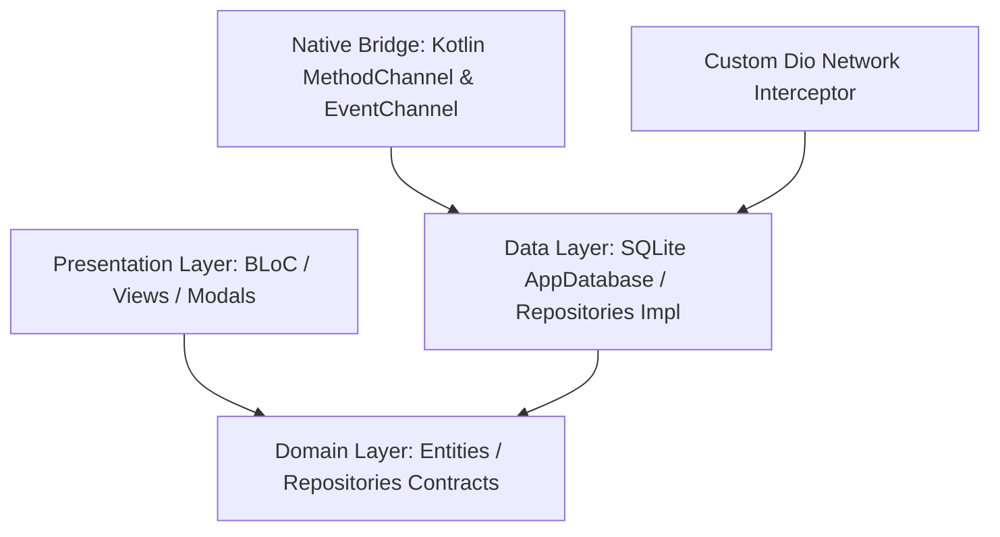
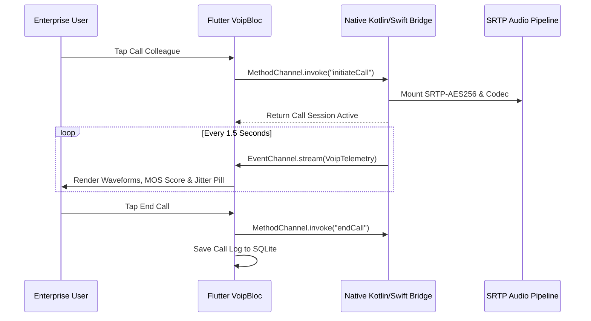

# OctetPulse

[](https://github.com/Safeer-Hussain/octet-pulse/actions/workflows/ci.yml)
[](https://flutter.dev)
[](https://dart.dev)
[](https://developer.android.com)
[](https://opensource.org/licenses/MIT)

> **OctetPulse** is an Enterprise Workforce Management, Automated Payroll Ledger, Real-Time Field GPS Tracking, Geofenced Attendance, and Native Encrypted VoIP Communication Suite in Flutter.

---

## Architecture & System Design

OctetPulse is engineered around a strict Feature-First Clean Architecture pattern, isolating domain contracts from SQLite data layers and native platform channels.



### Native VoIP & Telemetry Sequence



---

## Key Modules & Features

| Module | Core Functionality | Architecture Details |
|---|---|---|
| **Geofenced Attendance** | Lahore ASTP HQ 150m radius geofence, 1-tap clock-in/out, live shift duration timer | `AttendanceBloc`, Haversine formula, SQLite persistence |
| **Clearance Queue** | Team Lead approval queue for leave and overtime requests | Real-time state mutation with `AppFeedback` feedback |
| **Automated Payroll** | Monthly batch calculation, 1.5x overtime multiplier, 15% income tax, 5% provident fund | `PayrollBloc`, USD & PKR dual currency toggle |
| **Digital Payslip** | Breakdown sheet with gross, tax, PF, net payable, export to clipboard, disbursement marker | Modal bottom sheet, responsive typography |
| **Field GPS Tracker** | Live OpenStreetMap fleet tracker across Lahore corridors (Gulberg, Ring Road, DHA) | `flutter_map`, polyline routing, zero external API keys |
| **Fleet Simulator** | Live movement simulation updating speed, battery %, and destination ETA | Background stream timer with SQLite sync |
| **Encrypted VoIP** | Native SIP/WebRTC audio bridge, SRTP-AES256 encryption, live acoustic waveforms | Native Kotlin/Swift Method & EventChannels |
| **Operations Copilot** | Token-by-token streaming AI audit assistant querying local SQLite database | `AiCopilotCubit`, guarded by `try ... finally` |
| **Debug Drawer** | Configurable latency (400-850ms), HTTP 503 error simulator, incoming call trigger | Accessible via AppBar bug icon or long-press |

---

## UI, Theme & Landscape Safety

1. **Zero Hardcoded Colors**: 100% resolved via `Theme.of(context).colorScheme` supporting high-contrast Dark Slate and Executive Light modes.
2. **Landscape 360dp-Safe**: Micro-AppBar (`toolbarHeight: 36`), compact `NavigationRail` wrapped in `SingleChildScrollView(physics: ClampingScrollPhysics())`, and two-pane independent scroll controllers.
3. **Unique Hero Tags**: Zero duplicate scheduler exceptions across multi-tab shell (`fab_attendance_clockin`, `fab_payroll_disburse`, `fab_gps_dispatch`, `fab_voip_dialer`, `fab_ai_ops_clear`).
4. **Anti-AI Code Hygiene**: Vector Material Symbols only; zero emojis across all code, logs, and commit messages.

---

## Autonomous Verification Gate

OctetPulse includes an automated pre/post-flight verification gate at `tool/sprint_gate.dart`:

```bash
# Execute full verification gate (pub get, format, analyze, test, live physical device runtime)
dart run tool/sprint_gate.dart
```

---

## Clean-Room NDA Disclaimer

This software was engineered independently under a clean-room implementation paradigm. All corporate names, employee titles, and telemetry metrics are synthetic and designed exclusively for high-scale enterprise demonstration purposes.
